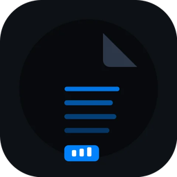

<p align="center">
  
</p>

<h1 align="center">OpenPDF</h1>

<h3 align="center">The React reading interface for OpenPDF</h3>

<p align="center">
  <a href="https://github.com/orgista/openPDF">Quest app</a> ·
  <a href="https://orgista.com/products/openpdf">orgista.com</a>
</p>

An immersive, warm-neutral PDF reading experience, a single-page React UI built from a
[Figma Make](https://www.figma.com/make/wgXUPCIw9EwovYHntRmDW1/OpenPDF) design.

The interface reimagines a document reader for focused, distraction-free reading:

- **Continuous scroll** through pages with lazy loading and smooth appear animations
- **Reading modes**, Normal (warm paper) and Dark, toggled from the toolbar
- **Table of contents** side panel with active-section tracking
- **Thumbnail rail + page dots** that surface on scroll and hover
- **Cursor-anchored double-click zoom** and a Fit / Full view toggle
- **Hold-and-drag page scrubbing** with a live page preview
- **Figure lightbox** (double-click a figure to expand)
- **Voice-search affordance** (visual stub)
- A warm amber accent on a deep neutral canvas, deliberately no "AI blue"

## Cross-platform

OpenPDF is built as **one web core, wrapped into native apps** for every target, iOS,
Android, Google TV, Apple TV, and Meta Quest, using [Capacitor](https://capacitorjs.com).
The Android build is a single artifact that ships to Google Play, installs on Google TV,
and sideloads onto Meta Quest as a 2D app. (It's also an installable PWA for the browser.)

See **[PLATFORMS.md](PLATFORMS.md)** for the full architecture, per-platform status, and
build steps. Reading is fully operable by keyboard / TV remote / controller (arrow keys,
Page Up/Down, Space, Home/End).

## Tech stack

- [React 18](https://react.dev) + [Vite 6](https://vite.dev)
- [Tailwind CSS v4](https://tailwindcss.com) (`@tailwindcss/vite`)
- [Capacitor](https://capacitorjs.com), native iOS / Android / Google TV / Quest shells
- [vite-plugin-pwa](https://vite-pwa-org.netlify.app), installable / offline web build
- [lucide-react](https://lucide.dev) icons
- Barlow / Barlow Condensed / DM Mono (Google Fonts, via `index.html`)

The entire experience lives in [`src/app/App.tsx`](src/app/App.tsx) and is driven by inline
styles, so it has no runtime UI-library dependency beyond the icon set.

## Getting started

```bash
npm install
npm run dev      # start the dev server (http://localhost:5173)
```

## Building

```bash
npm run build        # standard production build -> dist/
npm run preview      # preview the production build
npm run build:single # single self-contained HTML -> dist-single/index.html
```

`build:single` inlines all JS and CSS into one portable `index.html`, handy for hosting the
UI as a standalone, embeddable preview.

## Project structure

```
index.html              # Vite entry
src/
  main.tsx              # React root
  app/App.tsx           # the entire OpenPDF reader UI
  styles/
    index.css           # imports fonts + tailwind + theme
    fonts.css           # Google Fonts
    tailwind.css        # Tailwind v4 entry
    theme.css           # design tokens (colors, radii, typography)
```

---

Generated from a Figma Make design. Document content shown in the reader is placeholder text
for demonstration.

## Releases

[](https://github.com/orgista/openpdf-app/actions/workflows/ci.yml)
[](https://github.com/orgista/openpdf-app/releases)
[](https://scorecard.dev/viewer/?uri=github.com/orgista/openpdf-app)

Downloads live on the [Releases page](https://github.com/orgista/openpdf-app/releases): the built web bundle and app packages.
Release packages are built on our build Mac and published there.

- **Versions** follow [Semantic Versioning](https://semver.org/): `vMAJOR.MINOR.PATCH`. A version with a
  suffix (`v1.4.0-beta.1`) is a pre-release and is marked as one.
- **Cadence:** we ship when a change is ready, and at least one maintenance release a month while the project
  is in active development. Security fixes ship within 7 days of a confirmed report.
- **Every release** has a [CHANGELOG](CHANGELOG.md) entry (the release notes are taken from it), a `SHA256SUMS` checksum file and a GitHub attestation for every file.
- **Support:** only the latest release gets fixes. Please update before reporting a bug.

Check a download before installing it:

```bash
shasum -a 256 -c SHA256SUMS --ignore-missing
gh attestation verify openpdf-app-web.zip --repo orgista/openpdf-app
```

**Maintainers:** add the version's section to `CHANGELOG.md`, build and sign the release, then publish with

```bash
scripts/release-github X.Y.Z path/to/build-artifact
```

The script tags `vX.Y.Z`, uses the CHANGELOG section as the notes, uploads the files with `SHA256SUMS`, and can be
re-run safely. Full policy: [orgista release process](https://github.com/orgista/.github/blob/main/RELEASING.md).

